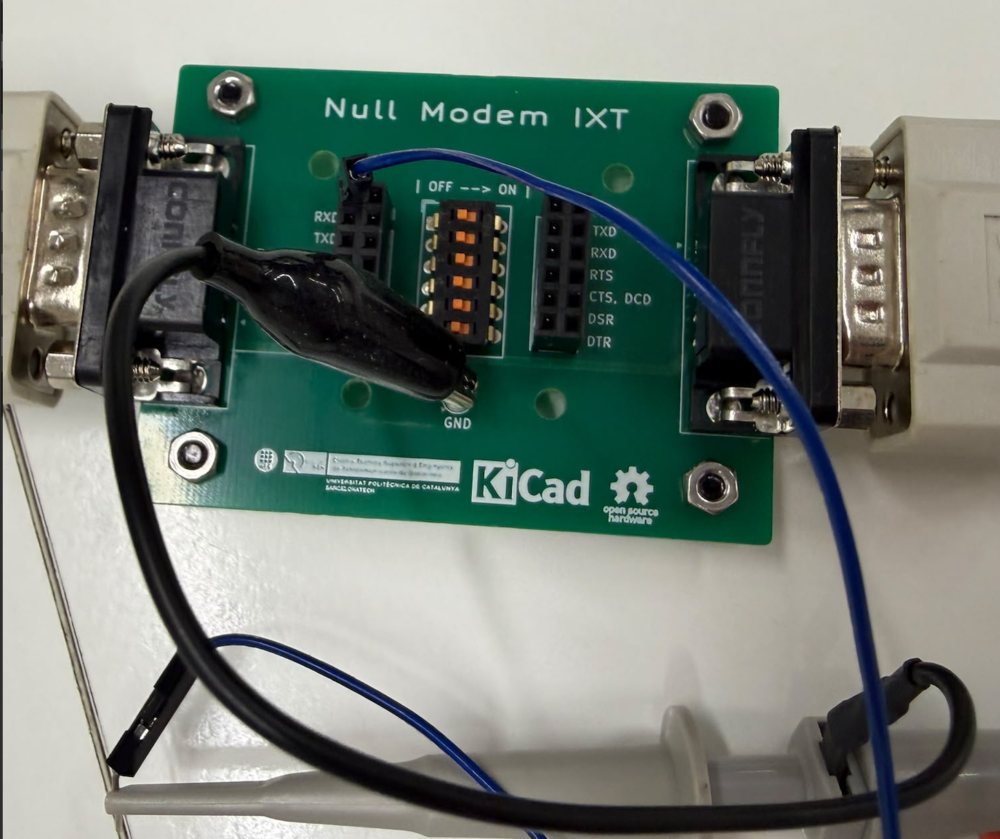

# Null Modem IXT

[](https://certification.oshwa.org/es000060.html)
[](https://ohwr.org/cern_ohl_s_v2.txt)
[](https://creativecommons.org/licenses/by-sa/4.0/)

`Null_Modem_IXT` is an open-source hardware board (v1.0) designed for RS-232 serial communication switching and signal monitoring. It allows users to toggle between a direct pass-through connection and a Null Modem cross-over configuration via a 6-position DIP switch, featuring integrated female test headers for oscilloscope signal probing and a dedicated PCB GND test point for attaching an oscilloscope alligator clip.

## Hardware Overview

| Front View | Back View | Lab Test Setup |
| :---: | :---: | :---: |
|  |  |  |

---

## Technical Specifications
- **Hardware Version**: 1.0
- **PCB Dimensions**: 70.01 mm × 51.96 mm
- **Design Software**: KiCad 9.0.3
- **Layer Count**: 2-layer THT design (Top Copper / Bottom Copper)
- **Primary Connectors**: 2× DB9 Female Right-Angle (90°) THT connectors with UNC 4-40 jack screws
- **DIP Switch**: Omron A6T Series (or equivalent), 6-position slide switch (12-pin DIP package) rated for $\ge 1,000$ operations min.
- **Test & Ground Interfaces**:
  - 2× 12-pin female test headers (2.54 mm pitch), one on each side, for connecting jumper wires to oscilloscope probes
  - 1× PCB GND Test Point for oscilloscope ground alligator clip attachment

---

## Repository Structure
```text
Null_Modem_IXT/
├── LICENSE_HARDWARE            # CERN-OHL-S-v2 License
├── LICENSE_DOCUMENTATION       # CC-BY-SA 4.0 License
├── README.md                   # Main English documentation
├── README_CA.md                # Catalan documentation
├── img/                        # Project photos, badges & test setups
│   ├── Null_Modem_IXT_Front.png
│   ├── Null_Modem_IXT_Back.png
│   ├── Null_Modem_IXT_Test.png
│   └── oshwa_ES000060.svg      # Official OSHWA Certification Mark
├── hardware/                   # KiCad source design files
│   ├── Null_Modem_IXT.kicad_pro
│   ├── Null_Modem_IXT.kicad_sch
│   ├── Null_Modem_IXT.kicad_pcb
│   └── Null_Modem_IXT.kicad_dru
├── production/                 # Manufacturing deliverables
│   ├── gerbers/                # Gerber RS-274X files
│   │   ├── Null_Modem_IXT-F_Cu.gbr
│   │   ├── Null_Modem_IXT-B_Cu.gbr
│   │   ├── Null_Modem_IXT-F_Mask.gbr
│   │   ├── Null_Modem_IXT-B_Mask.gbr
│   │   ├── Null_Modem_IXT-F_Silkscreen.gbr
│   │   ├── Null_Modem_IXT-Edge_Cuts.gbr
│   │   └── Null_Modem_IXT.drl
│   ├── Null_Modem_IXT_BOM.csv
│   └── Null_Modem_IXT_Schematic.pdf
```

---

## Bill of Materials (BOM)
| Reference | Qty | Value / Component | Package / Footprint | Description / Part Number |
| :--- | :--- | :--- | :--- | :--- |
| J1, J2 | 2 | DB9 Female 90° | DB9_Female_RightAngle_THT | RS-232 Female Connector, 90° PCB Mount |
| InterruptorAtoB1 | 1 | Omron A6T DIP Switch | DIP-12 Slide Switch | 6-Position DIP Switch, 12-pin ($\ge 1,000$ cycles) |
| PINFEMELLA(a)1, PINFEMELLA(b)1 | 2 | Female Pin Header 12x1 | PinHeader_1x12_P2.54mm_Vertical | Signal monitoring headers for oscilloscope probing |
| GND1 | 1 | PCB GND Test Point | TestPoint_Loop_THT | Ground test point for oscilloscope alligator clip |

---

## Open Source Hardware Compliance & Certification

This project is officially certified by the **Open Source Hardware Association (OSHWA)** and complies with the [OSHWA Open Source Hardware Definition](https://www.oshwa.org/definition/).

<a href="https://certification.oshwa.org/es000060.html">
  
</a>

### Certification Details
- **OSHWA UID**: [`ES000060`](https://certification.oshwa.org/es000060.html)
- **Certification Date**: October 03, 2026
- **Hardware Version**: 1.0
- **Creator**: Jordi Lino (Spain)
- **Project Type**: Education (`NULLMODEM`, `TELEMATICS`)

### License Terms
- **Hardware Design** (Schematics, PCB layout, Gerbers): Licensed under the **CERN Open Hardware Licence Strongly Reciprocal v2** ([CERN-OHL-S-v2](https://ohwr.org/cern_ohl_s_v2.txt)).
- **Software**: Licensed under the **Creative Commons Attribution-ShareAlike 4.0 International License** ([CC-BY-SA 4.0](https://creativecommons.org/licenses/by-sa/4.0/)).
- **Documentation & Media**: Licensed under the **Creative Commons Attribution-ShareAlike 4.0 International License** ([CC-BY-SA 4.0](https://creativecommons.org/licenses/by-sa/4.0/)).
