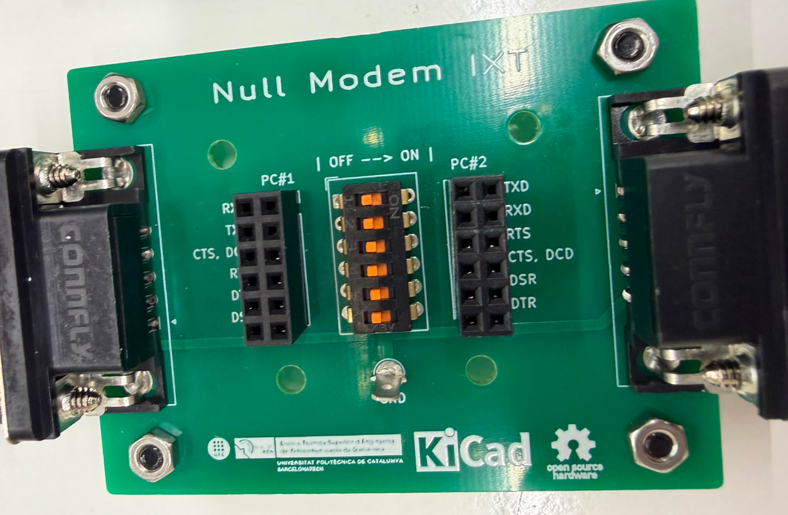
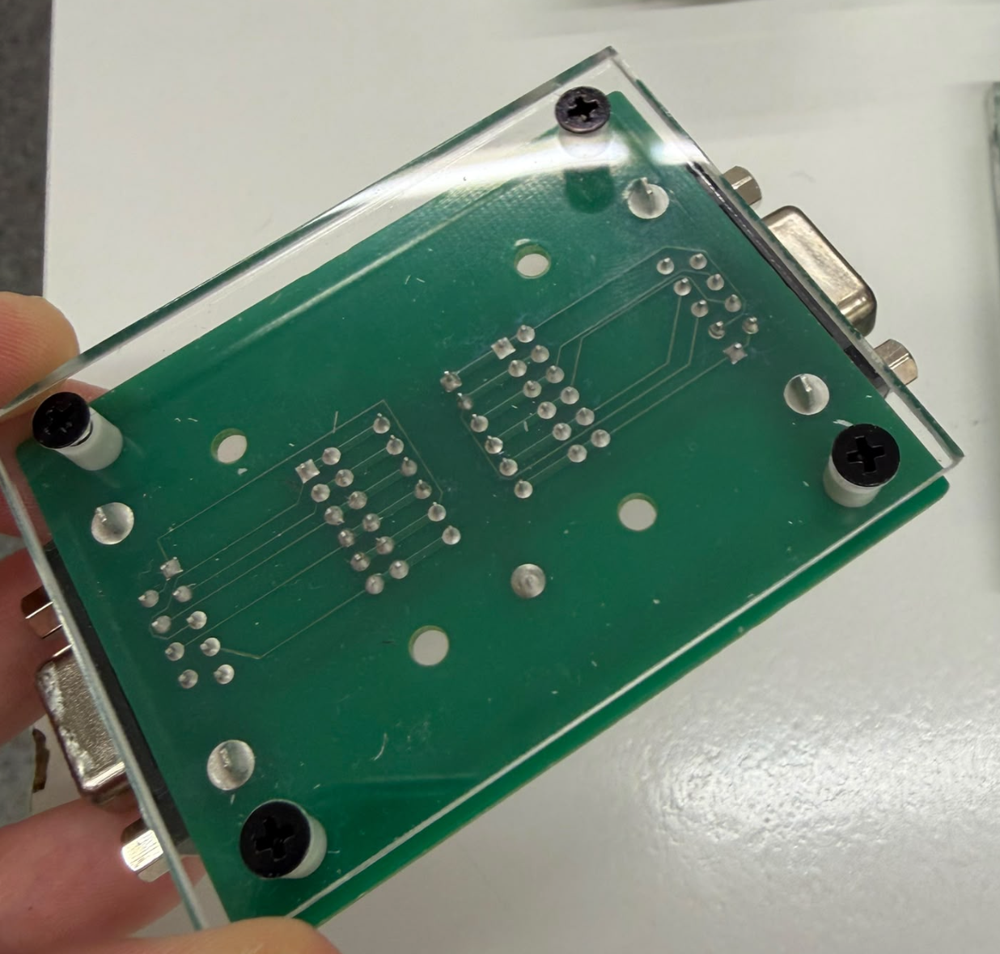

# Null Modem IXT

[](https://certification.oshwa.org/es000060.html)
[](https://ohwr.org/cern_ohl_s_v2.txt)
[](https://creativecommons.org/licenses/by-sa/4.0/)

Passive open-source hardware board (v1.0) for RS-232 serial communication switching and signal monitoring, developed for the Telematics Laboratories at UPC (Campus Nord). It implements a 6-position DIP switch (`SW2`) for Null Modem cross-over connections and provides two duplicated pairs of 1×6 female pin headers (`J3`/`J4` and `J5`/`J6`) plus a PCB GND test point (`J7`) for oscilloscope probing and custom jumper patching.

## Hardware Overview

| Front View | Back View | Lab Test Setup |
| :---: | :---: | :---: |
|  |  |  |

---

## Switch Configuration & Pinout

### DIP Switch Cross-Over Matrix (`SW2`)
Each switch in the 6-position DIP (`SW2-1` to `SW2-6`) bridges a crossed Null Modem line between `J1` and `J2`. Pins 1 (`DCD`) and 6 (`DSR`) are tied together on each DB9 connector, pin 5 (`GND`) is connected directly to the PCB GND test point (`J7`), and pin 9 (`RI`) is unconnected (`NC`) on both connectors.

> **DIP Switch Orientation (`SW2`):** **ON** = Slide switch to the **RIGHT** | **OFF** = Slide switch to the **LEFT**

| Switch | `J1` Side (Left) | `J2` Side (Right) | Function |
| :---: | :--- | :--- | :--- |
| **SW2-1** | Pins 1 & 6 (`DCD` + `DSR`) | Pin 4 (`DTR`) | Handshake cross-over (`DTR` $\rightarrow$ `DSR`/`DCD`) |
| **SW2-2** | Pin 2 (`RXD`) | Pin 3 (`TXD`) | Data cross-over (`J2 TXD` $\rightarrow$ `J1 RXD`) |
| **SW2-3** | Pin 3 (`TXD`) | Pin 2 (`RXD`) | Data cross-over (`J1 TXD` $\rightarrow$ `J2 RXD`) |
| **SW2-4** | Pin 4 (`DTR`) | Pins 1 & 6 (`DCD` + `DSR`) | Handshake cross-over (`DTR` $\rightarrow$ `DSR`/`DCD`) |
| **SW2-5** | Pin 7 (`RTS`) | Pin 8 (`CTS`) | Flow control cross-over (`J1 RTS` $\rightarrow$ `J2 CTS`) |
| **SW2-6** | Pin 8 (`CTS`) | Pin 7 (`RTS`) | Flow control cross-over (`J2 RTS` $\rightarrow$ `J1 CTS`) |

### Operating Modes

| Mode | SW2-1 | SW2-2 | SW2-3 | SW2-4 | SW2-5 | SW2-6 | Physical Switch Position |
| :--- | :---: | :---: | :---: | :---: | :---: | :---: | :--- |
| **Full Null Modem** | `ON` | `ON` | `ON` | `ON` | `ON` | `ON` | All 6 switches to the **RIGHT** |
| **3-Wire Null Modem** | `OFF` | `ON` | `ON` | `OFF` | `OFF` | `OFF` | `SW2-2` & `SW2-3` to the **RIGHT**; others to the **LEFT** |
| **Custom Patching** | `OFF` | `OFF` | `OFF` | `OFF` | `OFF` | `OFF` | All 6 switches to the **LEFT** |

In **Custom Patching** mode, all internal cross-overs are isolated so you can build straight-through or custom pinouts between the `J1` (`J3`/`J4`) and `J2` (`J5`/`J6`) headers using standard 2.54 mm jumper wires.

### Side Test Headers (`J3`/`J4` & `J5`/`J6`)
Each side features two 1×6 female pin headers wired in parallel (`J3` and `J4` on the `J1` side; `J5` and `J6` on the `J2` side), allowing simultaneous jumper patching and oscilloscope signal probing:

| Header Pin | `J1` Side (`J3` & `J4` in parallel) | `J2` Side (`J5` & `J6` in parallel) |
| :---: | :--- | :--- |
| **1** | `J1` Pins 1 & 6 (`DCD` + `DSR`) | `J2` Pin 4 (`DTR`) |
| **2** | `J1` Pin 2 (`RXD`) | `J2` Pin 3 (`TXD`) |
| **3** | `J1` Pin 3 (`TXD`) | `J2` Pin 2 (`RXD`) |
| **4** | `J1` Pin 4 (`DTR`) | `J2` Pins 1 & 6 (`DCD` + `DSR`) |
| **5** | `J1` Pin 7 (`RTS`) | `J2` Pin 8 (`CTS`) |
| **6** | `J1` Pin 8 (`CTS`) | `J2` Pin 7 (`RTS`) |

---

## Technical Specifications
- **Hardware Version**: 1.0
- **PCB Dimensions**: 70.01 mm × 51.96 mm
- **Design Software**: KiCad 9.0.3
- **Layer Count**: 2-layer THT (Top Copper / Bottom Copper)
- **Serial Connectors**: 2× DB9 Female Right-Angle (90°) THT with UNC 4-40 jack screws (`J1`, `J2`)
- **DIP Switch**: Omron A6T Series (or equivalent), 6-position slide switch ($\ge 1,000$ operations min.) (`SW2`)
- **Probing & Ground**:
  - 4× 1×6 female pin headers (2.54 mm pitch), arranged as two duplicated parallel pairs (`J3`/`J4` on the `J1` side and `J5`/`J6` on the `J2` side), for jumper wire patching and oscilloscope probes
  - 1× PCB GND test point (`J7`) for oscilloscope ground alligator clip

---

## Repository Structure
```text
Null_Modem_IXT/
├── LICENSE_HARDWARE            # CERN-OHL-S-v2 License
├── LICENSE_DOCUMENTATION       # CC-BY-SA 4.0 License
├── README.md                   # Project documentation
├── img/                        # Project photos & test setups
│   ├── Null_Modem_IXT_Front.png
│   ├── Null_Modem_IXT_Back.png
│   └── Null_Modem_IXT_Test.png
├── hardware/                   # KiCad source design files
│   ├── Null_Modem_IXT.kicad_pro
│   ├── Null_Modem_IXT.kicad_sch
│   ├── Null_Modem_IXT.kicad_pcb
│   └── Null_Modem_IXT.kicad_dru
├── production/                 # Manufacturing deliverables
│   ├── gerbers/                # Gerber RS-274X files
│   │   ├── Null_Modem_IXT-F_Cu.gbr
│   │   ├── Null_Modem_IXT-B_Cu.gbr
│   │   ├── Null_Modem_IXT-F_Mask.gbr
│   │   ├── Null_Modem_IXT-B_Mask.gbr
│   │   ├── Null_Modem_IXT-F_Silkscreen.gbr
│   │   ├── Null_Modem_IXT-Edge_Cuts.gbr
│   │   └── Null_Modem_IXT.drl
│   ├── Null_Modem_IXT_BOM.csv
│   └── Null_Modem_IXT_Schematic.pdf
```

---

## Bill of Materials (BOM)
| Reference | Qty | Value / Component | Package / Footprint | Description / Part Number |
| :--- | :--- | :--- | :--- | :--- |
| J1, J2 | 2 | DB9 Female 90° | DB9_Female_RightAngle_THT | RS-232 Female Connector, 90° PCB Mount |
| SW2 | 1 | Omron A6T DIP Switch | DIP-12 Slide Switch | 6-Position DIP Switch ($\ge 1,000$ cycles) |
| J3, J4, J5, J6 | 4 | Female Pin Header 1x6 | PinHeader_1x06_P2.54mm_Vertical | Duplicated 6-signal monitoring & patching headers |
| J7 | 1 | PCB GND Test Point | TestPoint_Loop_THT | Ground test point for oscilloscope alligator clip |

---

## Certification & Licensing

This project is certified by the **Open Source Hardware Association (OSHWA)** under the [OSHWA Open Source Hardware Definition](https://www.oshwa.org/definition/).

**[Official OSHWA Certification Record — UID: ES000060](https://certification.oshwa.org/es000060.html)**

- **OSHWA UID**: [`ES000060`](https://certification.oshwa.org/es000060.html)
- **Certification Date**: October 03, 2026
- **Hardware Version**: 1.0
- **Creator**: Jordi Lino — Telematics Laboratories Manager, Campus Nord, Universitat Politècnica de Catalunya (UPC), Spain
- **Project Type**: Education (`NULLMODEM`, `TELEMATICS`)

### Licenses
- **Hardware Design** (Schematics, PCB layout, Gerbers): [CERN-OHL-S-v2](https://ohwr.org/cern_ohl_s_v2.txt)
- **Documentation & Media**: [CC-BY-SA 4.0](https://creativecommons.org/licenses/by-sa/4.0/)
